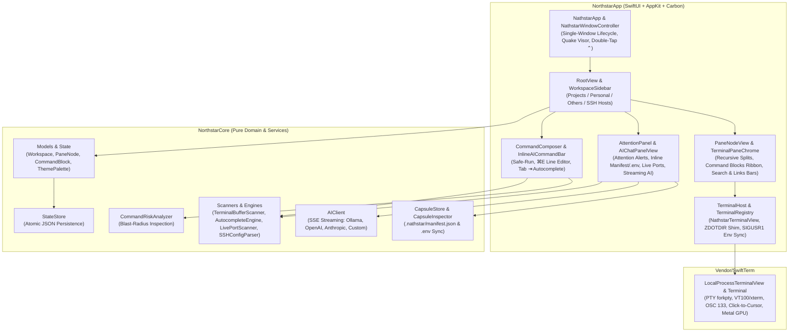

# Nathstar System Architecture

Nathstar is architected as a modular, strict-concurrency **Swift 6** application targeting **macOS 15+**. It cleanly separates pure domain logic and parsers (`NorthstarCore`) from the native SwiftUI/AppKit/Carbon presentation and PTY hosting layer (`NorthstarApp`).

---

## 1. High-Level Architecture Diagram

---

## 2. Target & Module Boundaries

The Swift Package (`Package.swift`) defines four distinct targets:

1. **`SwiftTerm` (`Vendor/SwiftTerm`)**:
   - Vendored VT100/xterm terminal emulator and `forkpty` process host.
   - Enhanced in Nathstar with:
     - **Embedded Metal Shader Source** (`MetalTerminalRenderer.swift`) so the 120Hz GPU pipeline compiles at runtime via `MTLDevice.makeLibrary(source:)` even on machines without Xcode's offline `metal` CLI compiler.
     - **Hybrid Click-to-Cursor Navigation** (`Terminal.moveCursorToActiveCommandPosition` in `Terminal.swift`), which routes single clicks or `⌥-Clicks` on the active command line via `OSC 133` semantic prompt offsets or an automatic wrapped-line cell-offset fallback.
2. **`NorthstarCore` (`Sources/NorthstarCore`)**:
   - Zero UI dependencies (`Foundation` only).
   - Contains all `Codable` domain models (`NorthstarState`, `Workspace`, `PaneNode`, `TerminalSession`, `CommandBlock`, `CommandSnippet`, `SSHHostEntry`, `LivePortProcess`, `TerminalThemePreset`, `AppPreferences`).
   - Houses stateless, deterministic engines: `CommandRiskAnalyzer`, `CapsuleStore`, `CapsuleInspector`, `AIClient`, `TerminalBufferScanner`, `AutocompleteEngine`, `SSHConfigParser`, `LivePortScanner`, and `StateStore`.
3. **`Nathstar` (`Sources/NorthstarApp`)**:
   - `@MainActor`-isolated SwiftUI + AppKit application shell.
   - Coordinates live views through `AppModel` and `TerminalRegistry`.
4. **`NorthstarCoreChecks` (`Sources/NorthstarCoreChecks`)**:
   - Fast standalone verification executable run by `./scripts/check.sh` and `./scripts/package-macos.sh` before every build.

---

## 3. Core Technical Subsystems

### 3.1 Deferred Non-Zero Frame PTY Initialization (`NathstarTerminalView`)

A subtle bug in many SwiftUI-hosted terminal emulators occurs when `forkpty` is called inside `makeNSView` while the `NSView` frame is still `0×0`: the shell starts with a `0×0` window size (`TIOCSWINSZ`), and when SwiftUI lays out the view milliseconds later, resize debouncing can suppress `SIGWINCH`, leaving `zsh` (especially with themes like Powerlevel10k) without a rendered prompt.

**Nathstar's Solution:**
`NathstarTerminalView` (a subclass of `LocalProcessTerminalView` in `Sources/NorthstarApp/TerminalHost.swift`) defers `startProcess` until `setFrameSize` or `layout()` reports a real non-zero geometry (`frame.width > 10 && frame.height > 10`). Every new tab and split pane starts with exact row/column dimensions on the very first `forkpty` call.

### 3.2 Transparent `ZDOTDIR` Shim, Silent `SIGUSR1` Env Injection & `OSC 133` Hooks

When launching `zsh`, `TerminalRegistry.prepareSilentZshDotDir` creates a lightweight per-process shim directory that:

1. Restores `ZDOTDIR` to the user's real home/config directory and sources their real `.zshenv`, `.zprofile`, `.zshrc`, and `.zlogin` so all user aliases, plugins, and prompts load untouched.
2. Installs a `TRAPUSR1` signal handler and `preexec` hook that silently `source` a `0600` permissioned session file (`$NATHSTAR_ENV_FILE`). When you add or remove an environment variable in Nathstar's UI, `TerminalRegistry` writes the file and calls `kill(shellPid, SIGUSR1)`—updating the live shell's environment immediately with zero terminal output clutter.
3. Wraps `zle-line-init`, `preexec`, and `precmd` to:
   - Emit `OSC 133` semantic prompt markers (`\e]133;P;k=i;cl=m\a\e]133;B\a` and `\e]133;C\a`) for click-to-cursor navigation.
   - Record high-precision start/end timestamps (`$EPOCHREALTIME`), exit status (`$?`), `$PWD`, and command text to `$NATHSTAR_STATUS_FILE` so `TerminalPaneView.Coordinator` can create `CommandBlock` items and trigger the **"Explain & Fix with AI"** banner on non-zero exits.

### 3.3 Single-Window Reuse & Zero-Permission Global Hotkey (`Double-Tap ⌃`)

- **Window Lifecycle (`NathstarWindowController` & `MainWindowCloseInterceptor`)**:
  - Uses a single SwiftUI `Window("Nathstar", id: "main")` scene with `window.isReleasedWhenClosed = false`.
  - Both `⌘W` and the red window close button intercept `windowShouldClose` and call `window.orderOut(nil)`, hiding the window without deallocating any `LocalProcessTerminalView` instances.
  - Clicking the Dock icon (`applicationShouldHandleReopen`) or pressing `⌘T` calls `NathstarWindowController.restoreOrFocusWindow()`, bringing the single window back to the front.
- **Zero-Permission `Double-Tap ⌃` Detector**:
  - macOS blocks global `NSEvent.addGlobalMonitorForEvents(matching: .keyDown)` unless the user grants Accessibility/Input Monitoring permissions in System Settings.
  - Nathstar combines `NSEvent` flag monitors with 60Hz hardware modifier state polling via `CGEventSource.flagsState(.combinedSessionState)` (which requires **zero special permissions** on macOS) plus a Carbon `RegisterEventHotKey` for `⌃` + `` ` ``.

### 3.4 Live Port & Process Attribution (`LivePortScanner`)

When the **Ports** tab (`⇧⌘P`) is active in `AttentionPanel`:
1. `AppModel` queries `TerminalRegistry` for the root `shellPid` of every active terminal pane across all workspaces.
2. On a background utility task, `LivePortScanner` runs:
   - `/bin/ps -axo pid=,ppid=,comm=,args=` to build a complete process tree map.
   - `/usr/sbin/lsof -a -u <uid> -iTCP -sTCP:LISTEN -P -n -F pcn` to find all listening TCP sockets owned by the user.
3. For every listening port and active child process, `LivePortScanner.resolveOwningSession` walks up the `ppid` chain until it hits one of Nathstar's `shellPid`s, attributing the port or process to its exact **Workspace** and **Terminal Pane**.

---

## 4. Local Persistence & Privacy Architecture

- **Atomic State Store (`Sources/NorthstarCore/StateStore.swift`)**:
  - All application state is persisted to `~/Library/Application Support/Nathstar/state.json` using atomic file writes (`.atomic`).
  - Save operations are debounced by 300ms during normal interaction and flushed synchronously inside `applicationWillTerminate` on `⌘Q` along with scrollback snapshots.
- **Strict Local-First Privacy**:
  - Nathstar contains zero analytics SDKs, zero crash-reporting beacons, and zero background network calls unless the user explicitly invokes an AI prompt or refreshes their local Ollama model list.
