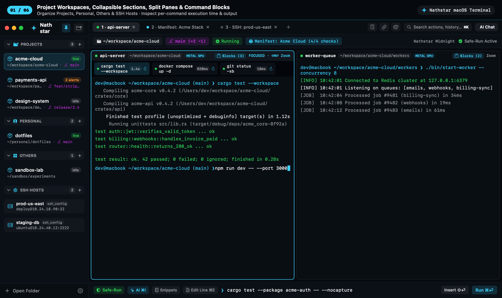
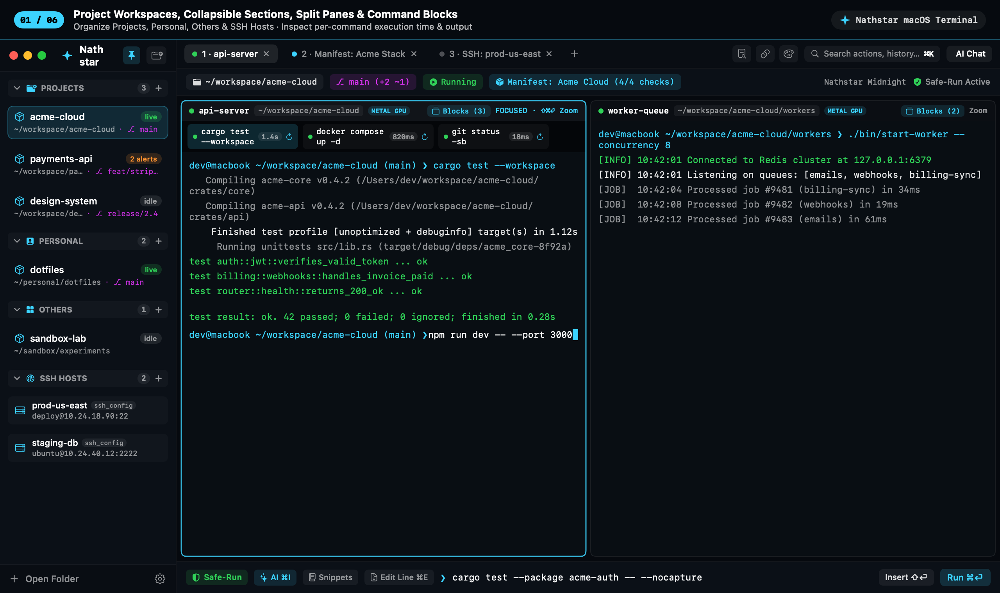
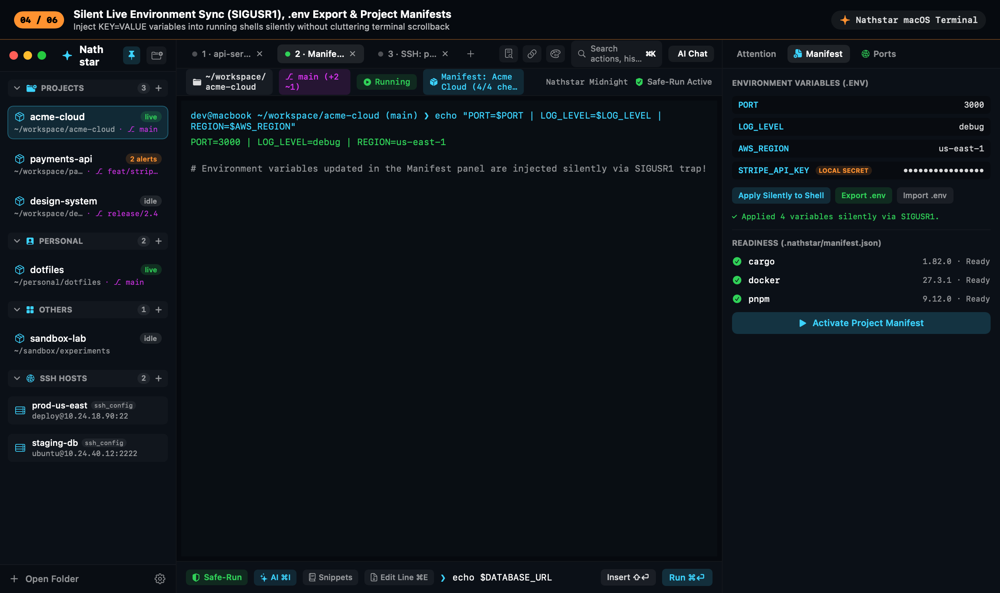
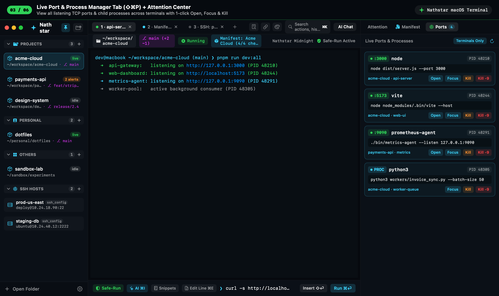
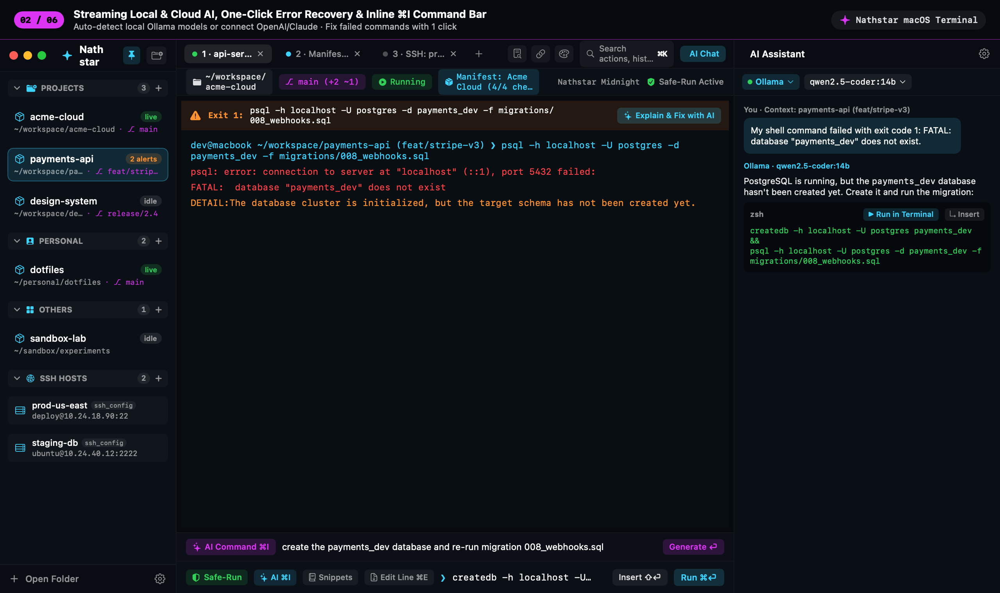
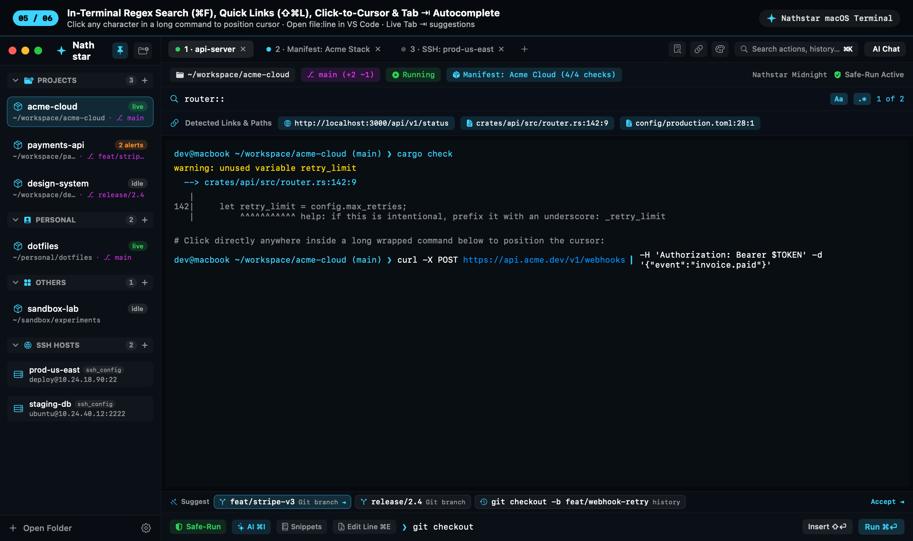
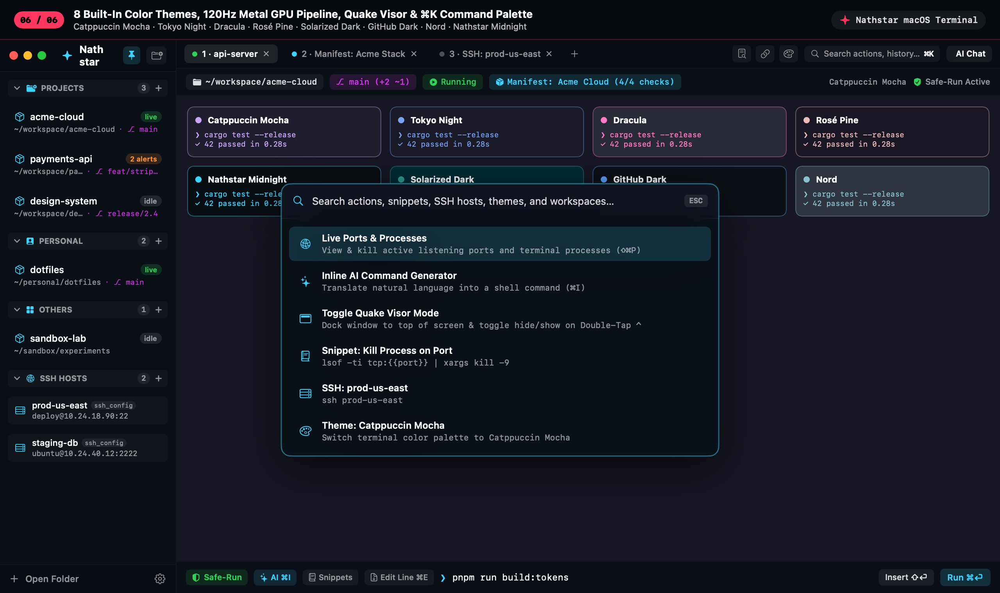

# Nathstar Feature Guide

Nathstar is designed around a single core belief: **a terminal should understand your projects, your running processes, your environment variables, and your command history—without ever sending your private data to a third-party cloud.**

Below is the complete reference for every feature in Nathstar.

---

## 1. Project Workspaces & Customizable Sidebar

Unlike traditional terminal emulators where every window is an isolated shell directory, Nathstar organizes your work into persistent **Workspaces** mapped to project folders.

- **Collapsible, Customizable Sidebar Sections**:
  - Workspaces are organized into **Projects**, **Personal**, and **Others**, plus a dedicated **SSH Hosts** section.
  - Click any section header to collapse or expand it; when collapsed, its workspaces are hidden and a live green indicator badge shows if any background shell is active inside that section.
  - **Custom Section Titles**: Right-click any section header and choose **Rename Section…** to customize its name (or reset it to the default).
  - **Drag-and-Drop Organization**: Drag any workspace row and drop it onto another section header (`Projects`, `Personal`, or `Others`), or right-click a workspace and choose **Move to Section**.
- **Auto-Expanding Hover Rail (`⇧⌘S`)**:
  - Click the **Pin** icon in the sidebar header (or press `⇧⌘S`) to collapse the sidebar into a compact 44pt icon rail.
  - Hovering the mouse over the left rail smoothly slides out the full sidebar drawer over the terminal canvas without resizing your terminal columns.

---

## 2. Tabs, Recursive Split Panes & Window Ergonomics

- **Multi-Tab & Recursive Splits**:
  - Open multiple tabs per workspace (`⌘N`), reorder tabs via **drag-and-drop**, and split any pane **Vertically (`⌘D`)** or **Horizontally (`⇧⌘D`)** into an arbitrary recursive split tree.
  - **Pane Zoom (`⇧⌘⏎`)**: Temporarily maximize the focused split pane to 100% of the workspace canvas and press `⇧⌘⏎` again to restore the split layout.
  - **Equalize Splits (`⇧⌘=`)**: Reset all split dividers to an even 50/50 ratio.
- **Persistent Single-Window Lifecycle (`⌘W` vs. `⌘Q`)**:
  - Pressing **`⌘W`** or clicking the red traffic-light close button hides the Nathstar window while keeping every live PTY shell, SSH connection, and dev server running in memory.
  - Clicking the Dock icon, pressing **`⌘T`**, or **Double-tapping `⌃` (Control)** restores the exact window instantly without spawning duplicate windows.
- **Zero-Permission Global Hotkey (`Double-Tap ⌃`) & Quake Visor Mode**:
  - Double-tap the `⌃` (Control) key (or press `⌃` + `` ` ``) from any macOS app to summon Nathstar immediately.
  - Enable **Quake Visor Mode** in **Settings → General** (or via `⌘K`) to dock Nathstar to the top of the current display and toggle hide/show on `Double-tap ⌃`.

---

## 3. Native-Style Long Command Editing & Click-to-Position Cursor

Editing a 200-character command in a standard terminal normally requires holding the Left/Right arrow keys or memorizing `readline` chords. Nathstar provides two ways to edit commands as naturally as a native text field:

1. **Direct Click-to-Position Cursor in the Terminal Prompt**:
   - Click (or `⌥-Click`) directly on any character in your active terminal command—even across multi-line soft-wrapped commands.
   - Nathstar computes the exact character delta between the current cursor and your click (supporting both `OSC 133` semantic prompt zones and automatic prompt/RPROMPT boundary detection for Powerlevel10k, Starship, and Oh My Zsh) and moves the shell cursor straight to that character.
2. **Pull Active Terminal Line into the `Safe-Run` Composer (`⌘E`)**:
   - Press **`⌘E`** (or click **`Edit Line ⌘E`** in the bottom bar) at any time to pull whatever you have typed on the terminal prompt into the bottom multi-line macOS text editor.
   - Edit with standard macOS selection, copy/paste, and undo, then press **`⇧⏎` (`Insert ⇧⏎`)** to place the updated command back into the terminal prompt, or **`⌘⏎` (`Run ⌘⏎`)** to execute it.

---

## 4. IDE-Style Autocomplete, Safe-Run Blast-Radius Analyzer & Snippets

The bottom **`Safe-Run`** composer bar combines safety, speed, and reusable workflows:

- **Live Multi-Source Autocomplete (`Tab ⇥`)**:
  - As you type in the `Safe-Run` composer, a live **`Suggest`** bar ranks completions from:
    - **Git Branches**: Automatically completes local branch names when typing `git checkout `, `git switch `, `git merge `, `git rebase `, or `git push origin `.
    - **Command Blocks & `~/.zsh_history`**: Matches your previously executed commands with duration and exit-code badges.
    - **Saved Workflow Snippets**: Matches reusable command templates.
    - **Live File & Folder Paths**: Completes files and directories relative to the active pane's working directory.
  - Press **`Tab ⇥`** or click any suggestion pill to accept it.
- **Pre-Execution Blast-Radius Analyzer**:
  - Before sending a command from the composer, `CommandRiskAnalyzer` checks for dangerous operations (`git push --force`, `rm -rf` in `/` or `~`, piping `curl`/`wget` directly into `sudo sh`, recursive permission changes, `git reset --hard`) and presents a clear confirmation dialog explaining the blast radius.
- **Parameterized Workflow Snippets**:
  - Save commands with `{{parameter}}` placeholders (e.g., `lsof -ti tcp:{{port}} | xargs kill -9` or `docker exec -it {{container}} /bin/sh`) via the **`Snippets`** menu in the composer or **Settings → Snippets**.

---

## 5. Warp-Style Command Blocks Ribbon & One-Click Error Recovery

- **Command Blocks Ribbon**:
  - Every command executed in a zsh pane is recorded via `preexec`/`precmd` hooks with its working directory, exit code, high-precision execution duration (`42ms`, `1.8s`, `2m 14s`), and captured output snippet.
  - Click **`Blocks (N)`** in the pane header to view recent commands as interactive pills:
    - **Click a block** to open the inline output inspector, copy just that command's output, load it into the composer, or send it to AI.
    - **Click `↻`** to re-run the command immediately.
- **One-Click "Explain & Fix with AI" Banner**:
  - Whenever a command exits with a non-zero status code (excluding `Ctrl+C`), an inline banner appears at the top of the pane (`Exit <code>: <command> · ✨ Explain & Fix with AI`).
  - Clicking it opens the AI Assistant and attaches the failed command along with the last 35 lines of terminal output to generate an immediate fix.

---

## 6. Silent Live Environment Variables, `.env` Sync & Project Manifests

- **Silent Live Environment Injection (`SIGUSR1`)**:
  - Add, edit, or delete `KEY=VALUE` variables in the **Manifest** tab of the right panel or the **Project Manifest (`⇧⌘E`)** sheet.
  - Clicking **Set & Apply** writes the variables to a private `0600` session file and sends `SIGUSR1` to the running `zsh` process. A `TRAPUSR1` handler sources the updated variables **silently in the background** without printing `export KEY=VALUE` into your terminal buffer.
- **One-Click `.env` Import & Export**:
  - Export workspace environment variables to a standard `.env` file in your project root or import an existing `.env` file with one click.
  - Secret-like variable names (`*_KEY`, `*_TOKEN`, `*_SECRET`, `*_PASSWORD`) are automatically stored locally and excluded from version-controlled `.nathstar/manifest.json` files.
- **Portable Project Manifests (`.nathstar/manifest.json`)**:
  - Define required CLI tools, startup commands, auto-start services, health checks, and split-pane layouts (`horizontal`, `vertical`, or `grid`) so any collaborator can launch the entire project stack in one click.

---

## 7. Live Port & Process Manager (`⇧⌘P`)

Located in the right-hand panel under the **`Ports`** tab (right after `Attention` and `Manifest`):

- **Real-Time Port & Process Discovery**:
  - Scans active listening TCP ports (`lsof`) and process trees (`ps`) every 3 seconds while open.
  - Automatically walks parent PIDs (`ppid`) to identify which **Nathstar Workspace and Terminal Pane** spawned each server or background worker.
- **Filter & Search**:
  - Filter by `:port` (e.g., `3000`), `PID`, process name (`node`, `python`, `cargo`), or workspace name, and toggle between **Terminals Only** and **All Local** user processes.
- **One-Click Actions**:
  - **`Open`**: Launch `http://localhost:<port>` in your default browser.
  - **`Focus`**: Jump directly to the workspace, tab, and split pane running that process.
  - **`Kill`**: Send `SIGTERM` for a graceful shutdown.
  - **`Kill -9`**: Send `SIGKILL` to immediately terminate a wedged process or free a stuck port.

---

## 8. Local & Cloud Streaming AI (`⇧⌘I` & `⌘I`)

- **Multi-Provider Support**:
  - **Ollama (Local)**: Zero-config local inference with automatic model detection (`GET /api/tags`).
  - **OpenAI**: `gpt-4o`, `gpt-4o-mini`, etc.
  - **Anthropic**: `claude-3-5-sonnet-latest`, etc.
  - **Custom OpenAI-Compatible APIs**: LM Studio, Groq, OpenRouter, vLLM, or enterprise gateways.
- **Token-by-Token SSE Streaming**: Responses stream live into the chat panel with syntax-highlighted code blocks and one-click **`▶ Run in Terminal`** or **`↳ Insert`** buttons.
- **Inline AI Command Bar (`⌘I`)**: Press `⌘I` to describe a task in plain English right above the composer and translate it directly into an executable `zsh` command.

---

## 9. In-Terminal Search (`⌘F`) & Quick Links/File Paths (`⇧⌘L`)

- **Scrollback Find Bar (`⌘F`)**: Search the active terminal buffer with **Case Sensitive (`Aa`)** and **Regular Expression (`.*`)** modes, match counter, Next/Previous navigation, and clickable matched-line pills.
- **Quick Links & File Paths (`⇧⌘L`)**: Automatically extracts `http(s)://` URLs, `localhost:port` endpoints, and `path/to/file.swift:line:col` references from terminal output. Clicking a file path opens it at the exact line and column in VS Code (`code -g`) or your default macOS editor.

---

## 10. Themes, 120Hz Metal GPU Pipeline & Session Persistence

- **8 Built-In Color Themes**: Nathstar Midnight, Catppuccin Mocha, Tokyo Night, Dracula, Rosé Pine, Solarized Dark, GitHub Dark, and Nord.
- **Cursor Styles & Translucent Opacity**: Choose between Blinking/Steady Block (`█`), Beam (`▏`), and Underline (`▁`), and adjust terminal background opacity (`65%–100%`).
- **120Hz Metal GPU Rendering**: Toggle hardware-accelerated Metal shader rendering in **Settings → Terminal**.
- **Scrollback Snapshot Restore & Persistent `tmux` Mode**:
  - Automatically restores each pane's recent scrollback output when relaunching after `⌘Q`.
  - Optional **Background Multiplexer Mode (`tmux`)** in **Settings → General** attaches panes to persistent `tmux` sessions so long-running processes survive full app restarts.
